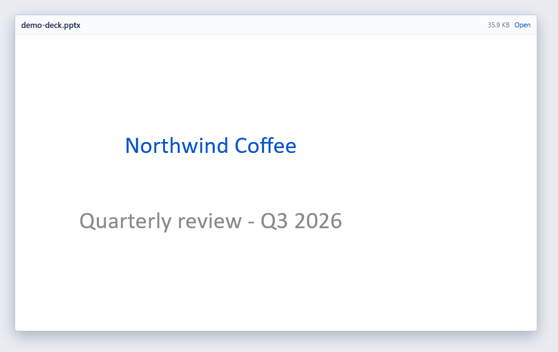
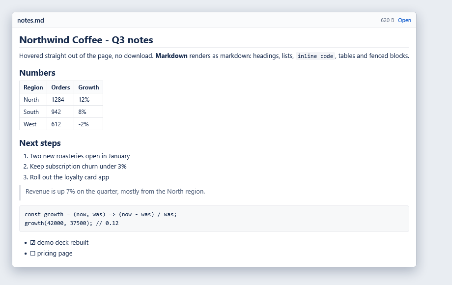
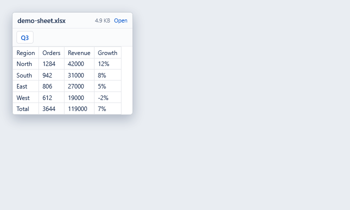
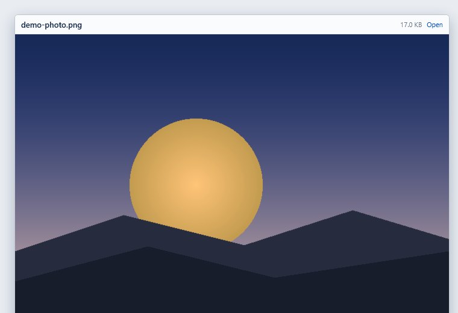

# Hover File Preview

Hover a link to a supported file and preview it in a card without leaving the
page. Manifest V3 extension for Firefox 128+ and Zen (primary), with a packaged
build for Chrome 120+.

## Screenshots

| PowerPoint deck | Markdown |
| --- | --- |
|  |  |

| Spreadsheet | Image |
| --- | --- |
|  |  |

## What it previews

| kind | extensions | limit |
| --- | --- | --- |
| image | png jpg jpeg gif webp bmp svg | 8 MB |
| pdf | pdf | 25 MB |
| text | txt md log csv json sql | 2 MB |
| sheet | xlsx xlsm | 10 MB |
| docx | docx | 20 MB |
| pptx | pptx | 30 MB |

Office ZIP entries are limited to 64 MiB each and 256 MiB total. Spreadsheet
previews are limited to 2,000 rows and 200 columns. Deck previews show up to 100
slides; the card identifies the first N of M when a deck is longer.

## How it behaves

- Hover a matching link for 300 ms, or Tab onto it, to open the card. Keyboard
  opening moves focus into the card; `Esc` closes it.
- The card opens near the link and is kept inside the window; it can be nudged
  if its content grows past a window edge.
- A deck opens in list mode, stacking slides vertically. It shows up to 100
  slides and identifies the first N of M when the deck is longer.
- Spreadsheet sheets are available as tabs.
- The card is a labeled dialog with live status and metadata announcements;
  sheet controls use tab and tabpanel semantics.
- `Esc` closes the card. It closes 200 ms after the pointer leaves it, and never
  while the pointer is on it. Scrolling the page closes it too; scrolling inside
  the card does not.
- `.md` files render as formatted Markdown: headings, lists, tables, fenced
  code, and safe links. Markdown images are links, not automatic image requests.
  Other supported text files show as plain text. Markdown links allow only
  `http(s)`, `mailto`, and fragment URLs.
- "Open" in the header opens the file itself.
- The interface is available in English and Traditional Chinese (`zh_TW`),
  selected by browser locale with English as the fallback.

## Privacy

- A supported file is fetched when its link is hovered or focused long enough to
  open a preview. Requests use `credentials: "same-origin"`: cookies are sent
  only for same-origin requests. Cross-origin files work only when the server
  allows them with CORS. Files are not proxied and no third-party server is used.
- Preview data stays in memory. The LRU cache is capped at 30 entries and 64
  MiB of retained data, including rendered HTML, media, and text; the extension
  writes nothing to disk.
- There is no telemetry, analytics, or remote code. The packaged bundle has no
  `eval` or `new Function`.
- The `scripting` permission injects the PowerPoint renderer into the tab's
  isolated world only when a `.pptx` link is previewed. The `http://*/*` and
  `https://*/*` host permissions let the extension inspect matching links and
  fetch their files. Other preview kinds load about 100 KB of scripts; the
  PowerPoint renderer is about 724 KB.

## Install

Packages are attached to the [GitHub releases](https://github.com/PhonezM/hover-file-preview/releases).

- **Firefox / Zen:** use the signed Firefox XPI when one is attached. Release
  Firefox requires AMO signing; the CI signs only when its AMO API secrets are
  configured.
- **Chrome:** build the project and side-load the unpacked `build/chrome`
  directory from `chrome://extensions` with Developer mode enabled.
- **Development (Firefox):** after building, open
  `about:debugging#/runtime/this-firefox`, choose **Load Temporary Add-on…**,
  and select `build/firefox/manifest.json`.

## Repository layout

| path | what |
| --- | --- |
| `src/` | the extension source: `lib.js` (helpers + markdown), `content.js` (the card), `zip.js` (zip reader), `docx.js` and `xlsx.js` (readers), `pptx.src.js` (the slide renderer's source) |
| `src/background.js` | injects the PowerPoint renderer on demand |
| `dist/` | `pptx.js`, the renderer bundle built from `src/pptx.src.js` |
| `_locales/` | English and Traditional Chinese interface strings |
| `tests/` | unit tests (`lib.test.mjs`) and packaged-extension browser tests (`e2e.mjs`) |
| `demo/` | a small deck, sheet, image and markdown file plus an `index.html` to try the preview locally |
| `docs/` | screenshots and icons |

## Build

```bash
npm ci                    # Node.js 22 or later
npm run build:renderer    # only after editing src/pptx.src.js
bash build.sh             # creates both browser packages and build/ trees
```

`build.sh` writes the packages attached to GitHub releases:

| output | goes to |
| --- | --- |
| `hover-file-preview-firefox.zip` | Firefox package (keeps the Gecko id) |
| `hover-file-preview-chrome.zip` | Chrome package (Gecko block removed, `minimum_chrome_version` added) |

Both are plain zips with `manifest.json` at the root. `build/firefox/` and
`build/chrome/` are the unpacked trees.

- `src/pptx.src.js` is the readable renderer source; `dist/pptx.js` is the
  committed bundle built from it. Rebuild it with `npm run build:renderer` only
  after changing the source.
- `./build.sh` minifies the bundle into the package and stamps the build id that
  the card shows in its header.
- `icons/` holds the PNG icon sizes both packages require (Chrome does not accept
  an SVG icon in the manifest).
- The readers use the built-in ZIP reader in `src/zip.js` and
  `DecompressionStream`; `jszip` is not a dependency.

## Testing

```bash
npm test          # 24 unit tests
npm run test:e2e  # 6 Chromium cases against the packaged extension
npm run lint      # web-ext lint: 0 errors (9 warnings: 7 innerHTML, 2 version-key)
npm run size      # checks renderer (800 KB), unpacked (1 MB), and zip (350 KB) budgets
```

The e2e cases cover PowerPoint, spreadsheet, Word, Markdown, image, and keyboard
previews.

## Limitations

- Cross-origin files require the server to allow access with CORS.
- Spreadsheets render values only — no cell styles, no conditional formatting.
  Dates (via the cell's number format), booleans and merged ranges are kept.
- PowerPoint SmartArt and document animations are not reproduced.
- Word headers, footers, columns and footnotes are kept, but a page is a
  continuous flow in the card rather than a sheet of paper.
- Legacy binary formats (`.doc`, `.ppt`, `.xls`) are not supported.
- PDF and image previews go through the page's own CSP; strict `img-src` /
  `frame-src` rules can block them.

## Licence

MIT — see [LICENSE](LICENSE). Third-party code and its licences:
[THIRD_PARTY.md](THIRD_PARTY.md).

## Project policies

- [Contributing](CONTRIBUTING.md)
- [Security](SECURITY.md)
- [Privacy](PRIVACY.md)
- [Releasing](RELEASING.md)
