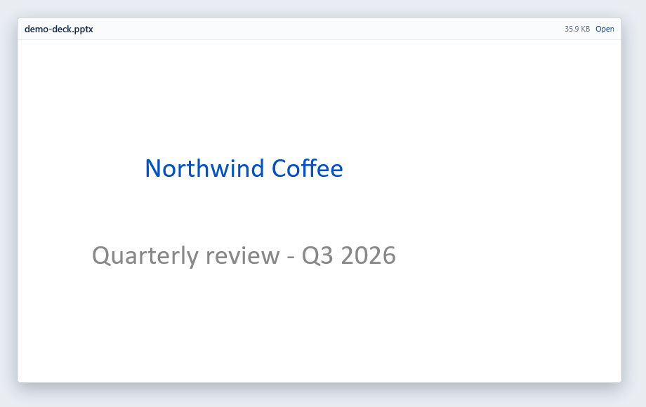
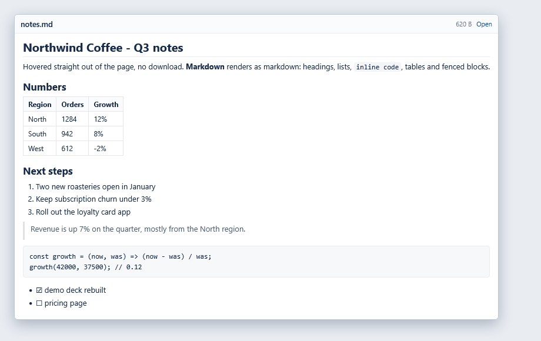
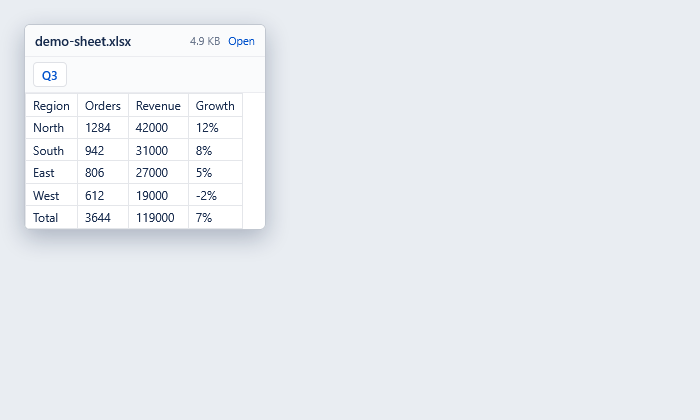
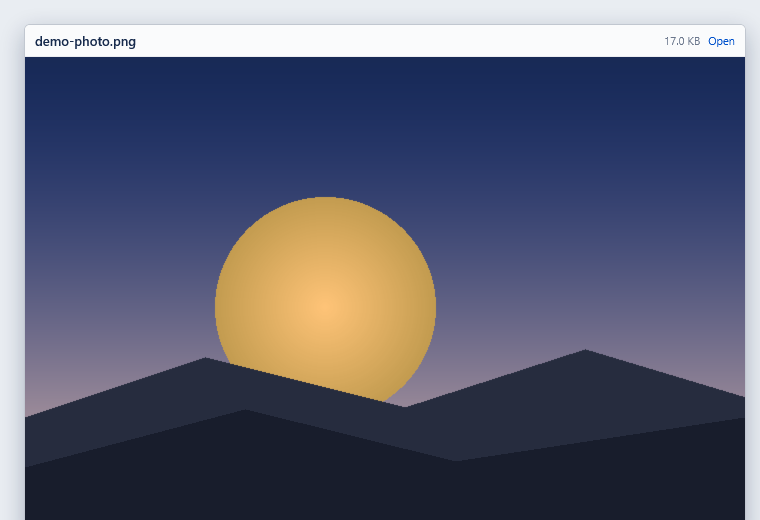

# Hover File Preview

Hover a link to a file and read it in a card, without downloading it and without
leaving the page. Firefox / Zen extension (Manifest V3).

## Screenshots

| PowerPoint deck | Markdown |
| --- | --- |
|  |  |

| Spreadsheet | Image |
| --- | --- |
|  |  |

## What it previews

| kind | extensions | limit |
| --- | --- | --- |
| image | png jpg jpeg gif webp avif bmp svg | 8 MB |
| pdf | pdf | 25 MB |
| text | txt md log csv json xml yml yaml js ts css html ini | 2 MB |
| sheet | xlsx xlsm | 10 MB |
| docx | docx | 20 MB |
| pptx | pptx | 30 MB |

## How it behaves

- Hover a matching link for 300 ms and the card opens next to the pointer,
  flipped to whichever side has room, and kept inside the window.
- The card is placed once and never moves while the preview loads.
- A deck opens on slide 1 and scrolls slide by slide; each slide is drawn at the
  card's width.
- `Esc` closes the card. It closes 200 ms after the pointer leaves it, and never
  while the pointer is on it. Scrolling the page closes it too; scrolling inside
  the card does not.
- Markdown (`.md`, `.markdown`) renders as formatted markdown - headings,
  lists, tables, fenced code, links; any other text file shows as plain text.
- "Open" in the header opens the file itself.

## Privacy

- The file is fetched from the link's own origin with your existing cookies.
  Nothing is sent anywhere else.
- Nothing is stored on disk: previews live in memory, capped at 30 entries.
- No `eval` in the packaged code, so it runs under the MV3 CSP.

## Install

Temporary (any Firefox, for a test drive): `about:debugging#/runtime/this-firefox`
→ **Load Temporary Add-on…** → pick `manifest.json`.

Permanent: build the `.xpi` (below) and install it. Firefox Developer Edition,
Nightly and ESR accept an unsigned build once
`xpinstall.signatures.required` is `false` in `about:config`; a release Firefox
needs the package signed.

## Repository layout

| path | what |
| --- | --- |
| `src/` | the extension source: `lib.js` (helpers + markdown), `content.js` (the card), `zip.js` (zip reader), `docx.js` and `xlsx.js` (readers), `pptx.src.js` (the slide renderer's source) |
| `dist/` | `pptx.js`, the renderer bundle built from `src/pptx.src.js` |
| `tests/` | unit tests (`npm test`) |
| `demo/` | a small deck, sheet, image and markdown file plus an `index.html` to try the preview locally |
| `docs/` | screenshots and icons |

## Build

```bash
npm install              # once: esbuild + the renderer's four dependencies
npm run build:renderer   # only after editing pptx.src.js
./build.sh               # -> the two store packages below
```

`./build.sh` writes the submission packages, one per store:

| output | goes to |
| --- | --- |
| `hover-file-preview-firefox.zip` | addons.mozilla.org (keeps the gecko id, passes `web-ext lint` with 0 errors) |
| `hover-file-preview-chrome.zip` | Chrome Web Store (gecko block removed, `minimum_chrome_version` added) |

Both are plain zips with `manifest.json` at the root and only the shipped files
(11 entries). `build/firefox/` and `build/chrome/` are the unpacked trees, for
loading as a temporary add-on while developing.

- `src/pptx.src.js` is the readable renderer source; `dist/pptx.js` is the bundle
  built from it (committed, so `./build.sh` alone is enough unless the source changed).
- `./build.sh` minifies the bundle into the package and stamps the build id that
  the card shows in its header.
- `icons/` holds the PNG icon sizes both stores require (Chrome does not accept
  an SVG icon in the manifest).
- `npm test` runs the unit tests: link kind detection, file names, sizes, text
  decoding.

## Limitations

- Same-origin links only; a link to another host is blocked by CORS.
- Spreadsheets render values only — no cell styles, no conditional formatting.
  Dates (via the cell's number format), booleans and merged ranges are kept.
- PowerPoint SmartArt and document animations are not reproduced.
- Word headers, footers, columns and footnotes are kept, but a page is a
  continuous flow in the card rather than a sheet of paper.
- Legacy binary formats (`.doc`, `.ppt`, `.xls`) are not supported.
- PDF and image previews go through the page's own CSP; strict `img-src` /
  `frame-src` rules can block them.

## Licence

MIT — see [LICENSE](LICENSE). Third-party code and its licences:
[THIRD_PARTY.md](THIRD_PARTY.md).
